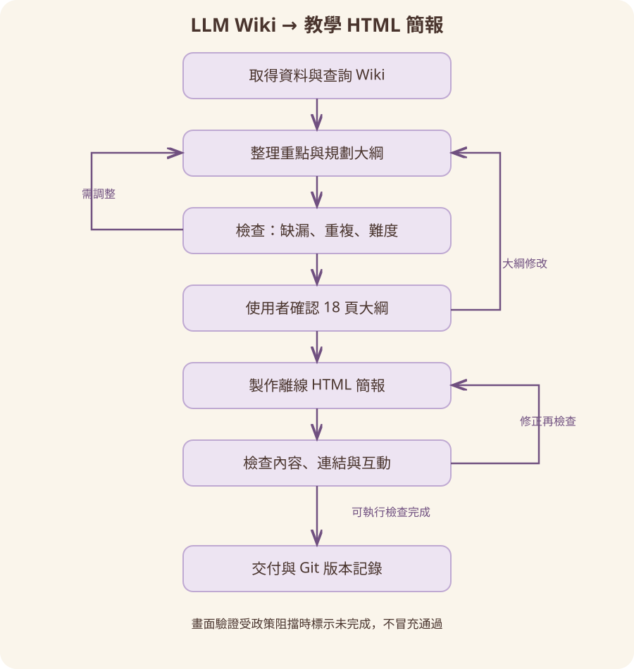
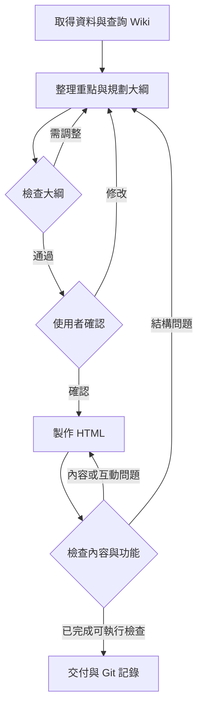

# 簡報製作 graph 與本次執行

## 重複與重新生成
- Ingest：逐篇讀取、整理摘要、更新主題頁、檢查、使用者審閱。
- 大綱 loop：缺漏、重複、難度不適合時回到整理重點；大綱變更重新確認。
- 成品 loop：來源、參數、連結與互動有問題時回製作，重查受影響項目。
- 瀏覽器政策阻擋的檢查列為未完成，不以其他測試冒充通過。

## 為什麼這樣設計
先固定教學範圍與來源，減少投影片做好才發現重複；檢查節點記錄問題、修正及重查結果，使流程可回溯。

## 本輪紀錄
沿用已確認 A 順序與 18 頁大綱，重新建置與測試。詳見 [實際執行報告](../../checks/graph-rerun-2026-11-23.md)。
